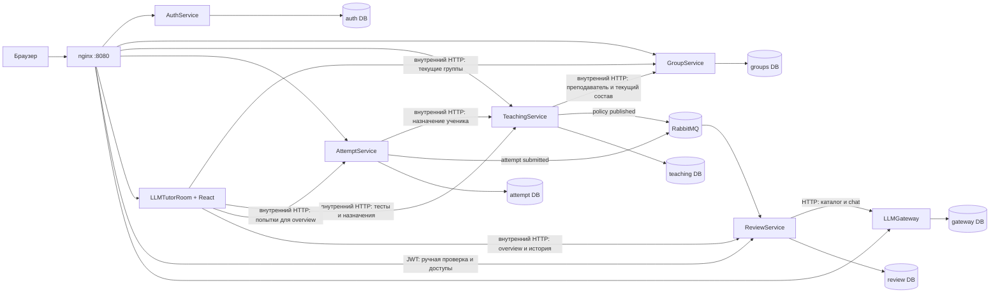
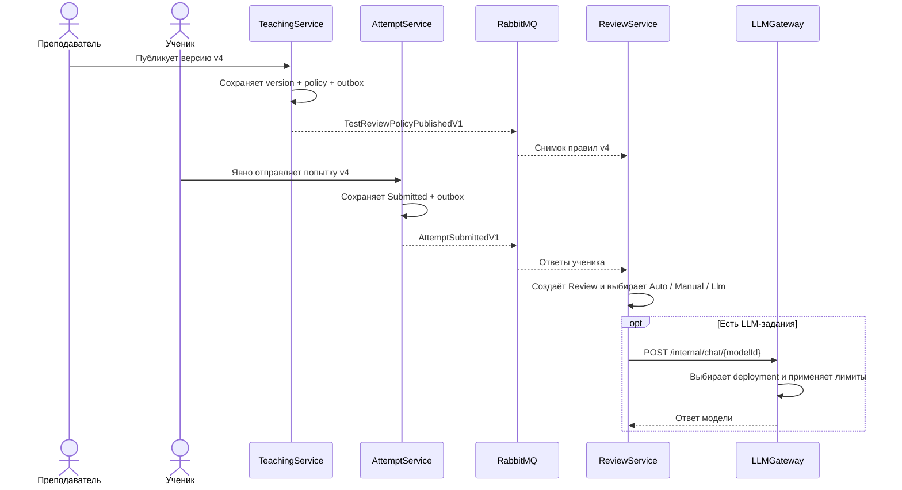

# Архитектура системы

Этот документ даёт общую карту проекта. Детали конкретного сервиса вынесены в
отдельные документы:

- [AuthService](auth-service.md)
- [GroupService](group-service.md)
- [TeachingService](teaching-service.md)
- [AttemptService](attempt-service.md)
- [LLMTutorRoom](llm-tutor-room.md)
- [ReviewService](review-service.md)
- [LLMGateway](llm-gateway.md)

## Границы ответственности

Система разделена не по экранам, а по владельцам данных и бизнес-правил.

| Сервис | Чем владеет | Чего не делает |
| --- | --- | --- |
| `AuthService` | Пользователи, роли, пароли и выдача JWT | Не хранит учебные данные |
| `GroupService` | Учебные группы, текущий состав и преподаватель группы | Не хранит тесты, назначения и попытки |
| `TeachingService` | Тесты, версии, назначения группам и опубликованные правила проверки | Не хранит состав групп, попытки и ответы учеников |
| `AttemptService` | Попытки учеников, ответы, серверный таймер и отправка вручную либо по дедлайну | Не хранит каталог тестов и не проверяет ответы |
| `LLMTutorRoom` | React-приложение, role-aware web-фасад и сборка overview | Не владеет бизнесовыми данными и собственной БД |
| `ReviewService` | Проверки, результаты заданий, ручная проверка, LLM-очередь, доступы и квоты преподавателей | Не хранит редактируемый каталог тестов и не выполняет LLM-запрос напрямую к provider-у |
| `LLMGateway` | Каталог моделей, deployment-ы, лимиты и вызов OpenAI-compatible provider-а | Не знает о тестах, учениках, попытках и баллах |

У каждого сервиса своя база данных. Сейчас они работают в одном экземпляре
PostgreSQL, но используют разные базы и не читают таблицы друг друга.

## Два независимых события

Для создания проверки `ReviewService` нужны два факта:

1. `TestReviewPolicyPublishedV1` — неизменяемые правила конкретной версии теста.
2. `AttemptSubmittedV1` — ответы конкретной отправленной попытки.

Суффикс `V1` обозначает версию схемы сообщения, а не номер версии теста. Если
wire-контракт когда-нибудь изменится несовместимо, для него нужно создать новый
тип и routing key, например `...V2`; поле `Revision` продолжит обозначать версию
конкретного теста.

Они приходят от разных сервисов и могут быть доставлены в любом порядке.
`TeachingService` не запускает проверку: он сообщает только о публикации правил.
Бизнес-триггером является сдача попытки учеником, а жизненным циклом проверки
полностью управляет `ReviewService`.

Если попытка пришла раньше policy, она сохраняется в `PendingSubmissions`.
После получения точной версии policy проверка создаётся автоматически. Новая
версия теста никогда не подменяет правила уже начатой или отправленной попытки.

## Синхронное и асинхронное взаимодействие

Синхронный HTTP используется, когда ответ нужен пользователю прямо сейчас:

- вход и получение текущего пользователя;
- чтение и редактирование тестов;
- управление группами и чтение текущего состава;
- старт и сохранение попытки;
- чтение результатов и истории;
- выставление ручного балла напрямую в `ReviewService`;
- управление доступами к моделям напрямую в `ReviewService`;
- управление моделями, деплойментами и лимитами напрямую в `LLMGateway`.

RabbitMQ используется только для фактов, которые должны пережить временную
недоступность другого сервиса:

- опубликована новая версия правил проверки;
- ученик окончательно отправил попытку;
- внутри `ReviewService` нужно выполнить или повторить LLM-проверку.

`TeachingService` и `AttemptService` записывают интеграционное событие в outbox в
той же транзакции, что и бизнесовое изменение. Фоновый процесс доставляет outbox
в RabbitMQ. `ReviewService` ведёт inbox по `EventId`, поэтому повторная доставка
не создаёт вторую проверку. Это модель доставки **at least once**: дубль допустим
на транспорте, но не в бизнесовых данных.

В событиях публикации правил используется постоянный `ModelId`. Ключ каталога
и ID модели у провайдера в них не передаются.

Внутренняя очередь `review.processing` устроена иначе: сообщение публикуется
после создания `Review` и содержит `ReviewId`, `AttemptId`, `RequestedAt`. Модель
worker читает из `Review`, отдельного дублирующего поля в сообщении нет. Если
публикация или worker падают, maintenance-процесс повторно ставит due-проверку в
очередь по её сохранённому состоянию.

## Версии, назначения и попытки

Логический тест имеет последовательные версии. Одновременно могут существовать
одна опубликованная версия и один редактируемый черновик. Публикация делает
черновик текущей версией, а предыдущую опубликованную версию — `Superseded`.
Преподаватель или администратор формирует группу в `GroupService`. Администратор
может менять её состав и преподавателя. Только текущий преподаватель группы
создаёт в `TeachingService` назначение с
точной ранее опубликованной версией, датой открытия и дедлайном. Эти сроки не
входят в версию теста, поэтому одно содержимое можно использовать в нескольких
группах и учебных периодах.

Назначение хранит внешний `GroupId`; список получателей не фиксируется.
`TeachingService` определяет доступ через текущий состав из `GroupService`.
Добавленный ученик получает прежние назначения группы без новых назначений.
Исключённый теряет доступ к активной работе: она исчезает из списка, а чтение,
возобновление, сохранение ответов и ручная сдача возвращают `404`.
Ответы сохраняются, сданные попытки и результаты остаются в истории. Автосдача
по дедлайну продолжает работать после исключения. При недоступности сервиса групп
новые назначения и операции с активными попытками возвращают `503`.

Смена преподавателя группы не переносит прежние назначения, попытки и проверки:
они остаются в истории автора назначенного теста. Новый преподаватель назначает
свои тесты текущей группе.

Попытка сохраняет назначение, группу, преподавателя, номер версии и список
допустимых заданий на момент старта. Уникальность по назначению и ученику даёт
одну попытку в рамках конкретного учебного случая, но разрешает повторное
назначение того же логического теста.
Поэтому:

- правки будущего черновика не меняют уже начатую работу;
- публикация v5 не отменяет попытку или проверку v4;
- старые незавершённые проверки остаются видимыми;
- завершённая история загружается отдельно и постранично.

При наступлении `EndsAt`, ограниченного дедлайном назначения, `AttemptService` автоматически фиксирует последние
сохранённые ответы, переводит попытку в `Submitted` и создаёт
`AttemptSubmittedV1`. Ручная и автоматическая отправка используют один дальнейший
поток проверки.

## Сеть и доверие

В полном Docker Compose рекомендуемой точкой входа в приложение является nginx
на порту `8080`. Он маршрутизирует только публичные `/api/*` и интерфейс React.
Любой путь `/internal/*` получает `404`.

Development Compose дополнительно публикует на хост прямые порты `AuthService`
и `LLMGateway` для отладки. `GroupService`, `TeachingService`, `AttemptService`, `ReviewService`
и `LLMTutorRoom` доступны пользователю только через разрешённые nginx-маршруты.
Административный API `LLMGateway` проверяет JWT и роль `Admin`. Его служебные
маршруты каталога и генерации работают без аутентификации.
Во внешнем окружении прямые host-порты закрываются
сетевыми правилами.

Публичные команды сервисов самостоятельно проверяют JWT и роль. `GroupService`
принимает управление группами преподавателя и администратора, `TeachingService`
назначает тесты только по команде преподавателя своей группы. `AttemptService`
принимает команды ученика, а `ReviewService` — ручную проверку преподавателя и
управление доступами администратора. Внутренние
API всех сервисов работают без аутентификации: они доступны в межсервисном
Docker-контуре, а nginx возвращает `404` для `/internal/*`. `LLMTutorRoom`
обращается к ним только для сборки overview и истории. При другом способе
развертывания доступ к внутренним API также ограничивается сетевыми правилами.

## Где искать код

- Регистрация зависимостей и запуск каждого сервиса находятся в его `Program.cs`.
- HTTP-граница — в `Controllers/`.
- Бизнесовые сценарии — в `Services/`.
- EF Core-модель и владение данными — в `Data/*DbContext.cs` и `Models/`.
- Общие wire-контракты событий и internal API — в
  [`AttemptService.Contracts`](../AttemptService.Contracts),
  [`GroupService.Contracts`](../GroupService.Contracts),
  [`TeachingService.Contracts`](../TeachingService.Contracts) и
  [`ReviewService.Contracts`](../ReviewService.Contracts).
- Docker-топология — в [`docker-compose.yml`](../docker-compose.yml), публичная
  маршрутизация — в [`infra/nginx`](../infra/nginx).

Для знакомства с кодом удобно сначала прочитать этот документ, затем документ
нужного сервиса и только после этого переходить к указанным в нём точкам входа.
