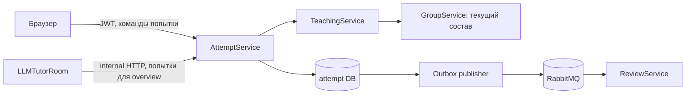
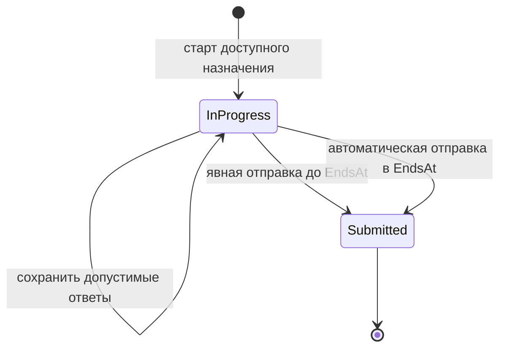
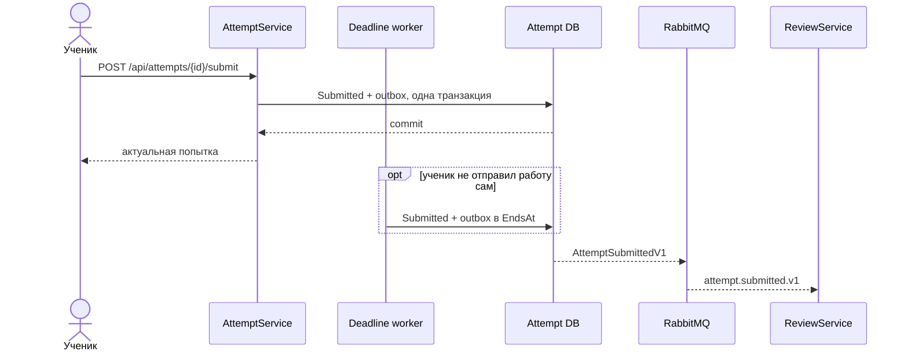

# AttemptService: прохождение тестов

## Назначение и границы владения

`AttemptService` — источник истины для попыток учеников. Он отвечает за старт
попытки, серверный срок, промежуточные ответы, окончательную отправку и надёжную
передачу факта отправки в `ReviewService`.

Сервис не владеет пользователями, тестами или результатами проверки. Идентификатор
ученика приходит из проверенного JWT, опубликованную версию и состав заданий сервис
получает из `TeachingService`. Тот сверяет доступ с текущим составом группы в
`GroupService`. После отправки `ReviewService` самостоятельно создаёт и
обрабатывает проверку.

## Данные и основные ограничения

В собственной базе `llm_tutor_attempts` находятся две таблицы:

- [`TestAttempts`](../AttemptService/Models/TestAttempt.cs) — назначение, группа,
  выбранная версия теста, ученик, статус, серверные времена, ответы и
  зафиксированный список допустимых заданий;
- [`AttemptSubmissionOutboxMessages`](../AttemptService/Models/AttemptSubmissionOutboxMessage.cs)
  — ещё не доставленные или сохранённые на время retention события
  [`AttemptSubmittedV1`](../ReviewService.Contracts/Events/AttemptSubmittedV1.cs).

Пара `AssignmentId + StudentUserId` уникальна: одному ученику разрешена одна
попытка на назначение. Тот же логический тест можно пройти снова после нового
назначения. `TestRevision` и `AllowedTaskIds` фиксируются при старте, поэтому
новая публикация не меняет уже начатую работу и нельзя сохранить ответ для
задания, которого в закреплённой версии не было.

Имя ученика также фиксируется при старте, чтобы фоновая отправка могла создать
полное событие без обращения к `AuthService`. `SubmissionReason` различает
ручную отправку `Student` и автоматическую отправку `Deadline`.

Идентификатор попытки — `Guid`, который создаёт сам `AttemptService`. Поэтому
события остаются глобально различимыми даже после переноса данных между
отдельными базами или повторного развёртывания сервиса.

`StateRevision` используется как optimistic concurrency token. Параллельные
autosave, ручная отправка и автоматическая отправка по дедлайну не перезаписывают более новое состояние:
операция перечитывает попытку и либо повторяет безопасное изменение, либо
возвращает конфликт.

## Жизненный цикл

При старте сервис:

1. запрашивает у `TeachingService` назначение для конкретного ученика;
2. проверяет членство в группе и интервал `AvailableFrom..Deadline`;
3. фиксирует назначение, группу, преподавателя, номер версии и видимые task id;
4. рассчитывает `EndsAt` как минимум личного лимита версии и дедлайна назначения;
5. при конкурентном повторном запросе возвращает уже созданную попытку.

Перед возобновлением, сохранением ответов и ручной сдачей сервис снова запрашивает
доступное ученику назначение. Состав проверяется один раз на запрос; внутренние
повторы записи при конфликте не создают повторных запросов членства. После
исключения из группы активная попытка скрывается из списка, а операции по её ID
возвращают `404`. Добавление в группу открывает прежние назначения, а возвращение
ученика позволяет продолжить сохранённую попытку в пределах её срока.

Список активных попыток фильтруется одним запросом назначений ученика.
Сданные попытки сохраняются в истории независимо от текущего состава; история
преподавателя остаётся у автора назначенного теста. Недоступность `TeachingService`
или `GroupService` запрещает операции с активной попыткой и возвращает `503`.

Явный `submit` до дедлайна переводит попытку в `Submitted` с причиной `Student`.
При наступлении `EndsAt` фоновый процесс автоматически отправляет последние
сохранённые ответы с причиной `Deadline`. Команды чтения и изменения также
проверяют срок, чтобы закрыть гонку с worker-ом. В обоих случаях статус и
`AttemptSubmittedV1` записываются в одной транзакции, поэтому проверка не теряется.
Исключение ученика из группы не удаляет ответы и не отменяет автоматическую
отправку по дедлайну.

## Доставка в ReviewService

Outbox publisher отправляет событие в exchange `review.integration` с routing
key `attempt.submitted.v1` и ждёт publisher confirm. При временной ошибке запись
остаётся в базе и повторяется позже; успешно доставленные записи удаляются
отдельным cleanup-проходом после retention.

`AttemptSubmittedV1` переносит также `AssignmentId` и `GroupId`, чтобы проверку
можно было связать с учебной группой без синхронного запроса. Повторный submit не
создаёт второе сообщение. Доставка остаётся моделью at least once, а
`ReviewService` подавляет дубли по `EventId` и `AttemptId`.

## HTTP, аутентификация и сеть

Публичная поверхность доступна через nginx:

- `GET /api/attempts` — попытки вошедшего ученика;
- `GET /api/attempts/{attemptId}` — одна принадлежащая ему попытка;
- `POST /api/attempts/assignments/{assignmentId}/start` — начать попытку по назначению;
- `PUT /api/attempts/{attemptId}/answers` — сохранить ответы;
- `POST /api/attempts/{attemptId}/submit` — явно отправить работу.

Эти endpoints проверяют JWT через `Shared.Auth` и требуют роль `Student`.
Идентификатор ученика всегда берётся из `NameIdentifier`, а не из тела или query.
DTO этой границы вынесены в
[`AttemptService.Contracts`](../AttemptService.Contracts/AttemptService.Contracts.csproj),
чтобы фасад использовал тот же wire-контракт без зависимости от реализации
сервиса.

`GET /internal/attempts/students/{studentUserId}` и
`GET /internal/attempts/teachers/{teacherUserId}` используются `LLMTutorRoom`
при сборке overview ученика и прогресса групп преподавателя. nginx возвращает `404` для всех
`/internal/*`; в полном Compose internal endpoint доступен только сервисам в
закрытой сети `backend`.

## Конфигурация, health и запуск

Основные секции [`AttemptService/appsettings.json`](../AttemptService/appsettings.json):

- `ConnectionStrings:DefaultConnection` — собственная PostgreSQL-база;
- `TeachingService` — адрес internal API каталога и timeout;
- `RabbitMq` — соединение с broker-ом;
- `AttemptOutbox` — публикация, retry, retention и cleanup;
- `AttemptDeadlineSubmission` — период фонового поиска и автоматической отправки
  попыток с наступившим сроком;
- `AttemptInputLimits` — максимальный размер HTTP-body, количество ответов,
  длина одного ответа и суммарная длина текста;
- `Auth:Jwt` — общие issuer, audience и signing key.

При старте применяются EF Core migrations, затем запускаются
`AttemptDeadlineSubmissionService`, `AttemptSubmissionOutboxPublisherService` и
`AttemptOutboxCleanupService`. `GET /health/live` проверяет процесс, а
`GET /health/ready` — доступность PostgreSQL и, если `RabbitMq:Enabled=true`,
RabbitMQ. В полном Compose сервис
не публикует host-порт и доступен снаружи только через nginx; для локального
запуска используется `http://localhost:5216`.

## С чего начать чтение кода

1. [`Program.cs`](../AttemptService/Program.cs) — DI, JWT, migrations, health и hosted services.
2. [`Controllers`](../AttemptService/Controllers) — публичная и внутренняя HTTP-граница.
3. [`Services`](../AttemptService/Services) — старт, autosave и ручная либо автоматическая отправка.
4. [`AttemptDbContext`](../AttemptService/Data/AttemptDbContext.cs) и
   [`Models`](../AttemptService/Models) — схема и инварианты хранения.
5. [`IntegrationEvents`](../AttemptService/Services/IntegrationEvents) — outbox и RabbitMQ.
