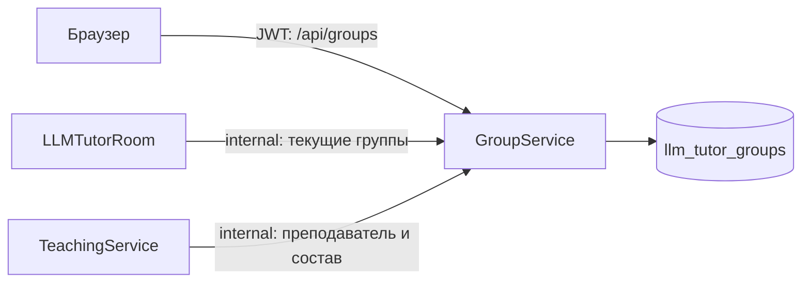

# GroupService: группы и текущий состав

## Назначение и границы владения

`GroupService` владеет учебными группами, их названием, текущим преподавателем и
составом учеников. Пользователи принадлежат `AuthService`; здесь сохраняются их
внешние идентификаторы. Один ученик может входить в несколько групп.

Администратор видит все группы, определяет их состав и меняет преподавателя.
Преподаватель создаёт и изменяет собственные группы. Назначения тестов принадлежат
`TeachingService`: создавать их может только текущий преподаватель группы.

В базе `llm_tutor_groups` находятся `StudyGroups` и `StudyGroupStudents`.
`Revision` группы защищает обновление состава и преподавателя от устаревших форм:
несовпадение ревизии возвращает `409`.



## Доступ к назначениям

Назначение в `TeachingService` хранит внешний `GroupId`, точную версию теста и
сроки. Список учеников не фиксируется. `TeachingService` получает текущий состав
по internal HTTP из `GroupService`.

Добавленный участник получает прежние назначения группы без новых назначений.
Исключённый теряет доступ к активной попытке: она скрывается из списка, а старт,
возобновление, сохранение ответов и ручная сдача возвращают `404`. Ответы
сохраняются, сданные попытки остаются в истории, автосдача по дедлайну продолжается.
После смены преподавателя прежние назначения, попытки и проверки остаются у
автора назначенного теста.

При недоступности `GroupService` сервисы возвращают `503` для операций, которым
нужен текущий состав или преподаватель. Группы не дублируются в других базах;
фоновой синхронизации состава и событий RabbitMQ здесь нет.

## API и аутентификация

Публичные маршруты проверяют JWT через `Shared.Auth` и роли `Teacher`, `Admin`:

| Метод и маршрут | Назначение |
| --- | --- |
| `GET /api/groups` | Группы текущего преподавателя или все группы администратора |
| `GET /api/groups/{groupId}` | Одна доступная группа |
| `POST /api/groups` | Создать группу |
| `PUT /api/groups/{groupId}` | Обновить название, состав и преподавателя с проверкой `Revision` |

Внутренние маршруты выполняются без аутентификации:

- `GET /internal/groups/{groupId}`;
- `GET /internal/teachers/{teacherUserId}/groups`;
- `GET /internal/students/{studentUserId}/groups`.

nginx возвращает `404` для `/internal/*`. Backend-сервисы обращаются к этим
маршрутам напрямую в межсервисной сети.

## Конфигурация и запуск

Основные настройки находятся в [`appsettings.json`](../GroupService/appsettings.json):
`ConnectionStrings:DefaultConnection` и общая секция `Auth:Jwt`.
EF Core migrations применяются при запуске. Для локального запуска нужна
PostgreSQL-база `llm_tutor_groups`:

```bash
dotnet run --project GroupService/GroupService.csproj
```

Локальный адрес — `http://localhost:5218`. В полном Compose сервис доступен
другим контейнерам как `http://group-service:8080`; host-порт не публикуется.
Публичный API доступен через nginx на `http://localhost:8080/api/groups`.

Основные точки входа:

- [`StudyGroupsController`](../GroupService/Controllers/StudyGroupsController.cs) — публичные команды и права;
- [`InternalGroupsController`](../GroupService/Controllers/InternalGroupsController.cs) — межсервисное чтение;
- [`StudyGroupService`](../GroupService/Services/StudyGroupService.cs) — состав и ревизии групп;
- [`GroupDbContext`](../GroupService/Data/GroupDbContext.cs) — схема собственной базы;
- [`GroupService.Contracts`](../GroupService.Contracts) — запросы и ответы.
